# Omega Logic cleanup — audit

© 2025–2026 ClearSky Energy Solutions LLC. Proprietary and Confidential.

Phase 1 only. This document maps Omega Logic and records what a person
actually sees. It does not change a page, a rule, or a tenant. Later
workstreams are separate pull requests. Nothing here is a merge.

The spine, from Thomas: a project is designed in Site Map (`/editor`) or
in Omega Prime (`/omega-prime`). That project's quote and bill of materials
become a purchase order in the OEM's workspace (Clean Cell is the example).
The OEM then fulfills it — allocate stock, or build it on a work order —
then ships, delivers, puts it on site, and closes custody and the serials,
with the deposit, the final payment, and the invoices on that same order.
That journey is what has to be one smooth step. The per-area findings below
are what the OEM sees after the order exists.

Walked 18 October 2026 against the sample Clean Cell workspace in
`scripts/_lib/logic-fixtures.js`, served only on `127.0.0.1`. Signed in as
a workspace administrator (`demo@cleancell.us`), a member
(`member@cleancell.us`), and the ClearSky owner (`tom@clearsky-usa.com`).
No production Firebase project was opened and no customer record was read.
Screenshots in `docs/logic-cleanup/` are that sample.

Thomas's rule, already applied to Site Map in `omega-editor-features.js`:
a control that is not working, not needed on the main path, a duplicate, or
still unfinished comes off the main navigation and into **Settings ›
Features**, where it can be switched back on. Nothing is deleted. The same
rule is applied below to Omega Logic. The order path itself stays on the
menu. A second screen that repeats it does not.

Out of scope for every workstream in this plan:

- `omega-prime.html` (another session is editing it).
- The editor v2 page.
- The Prime → Omega Logic handoff. Another agent is making that link open
  the person's own workspace. The staff directory below is the screen that
  handoff must not open for a tenant.
- Widening Firestore rules or tenant access. One later pull request may
  only add an explicit deny.
- Editing `omega-prime.html`. The journey pull request below is the
  function both doors call. The call from Prime waits until that file is
  free. The card that opens `/omega-logic` with no company is the other
  agent's fix, and this plan does not take it.

## The journey, and where it breaks

Traced in the code the buttons call, then opened in Chromium on the sample
host. No production project was read. One design does not become one order.

```
Site Map or Omega Prime
        │  projects/{id}          address, unit, drawing, Run
        ▼
   Bill of materials / quote screen
        │  rfqs/{id}              only if someone files from Site Map
        │                         Prime's quote is a table on the page
        ▼
   Quote Desk accept
        │  recipients/{oem}.contact    name and email, nothing else
        ▼
   (nothing writes orders/{id})
        │
        ▼
   Someone retypes a PO in the OEM office
        orders/{id}               no project id, no drawing, no Run
        ▼
   Price → Deposit → allocate or build → Ship → Deliver → On site → Complete
```

### What each handoff keeps

| Handoff | Record | What carries | What is lost or typed again | Dead end |
|---|---|---|---|---|
| Design in Site Map | `projects/{id}`: address string, equipment, BOM, Run totals (`capex`, `capexSource: 'site-map'`) | The drawing | — | Push to Logic does not send it on |
| Design in Prime | `omega-prime-project.js` `projectDoc`: address, `bessList` catalog key, `mapState`, `grid`, `load`, `prime.layout`, `prime.run` | A project the editor can open with `?from=prime` | `type` and `siteScopes` are written as battery. The Run total is Prime's cost model, stored as `prime.run`, and Site Map's capex rollup does not read it | Open in Site Map is the only way out of the quote |
| Push to Logic, from the editor | `omegaPushLogic` opens `/omega-prime?addr=&project=&step=logic` | The address string and the project id, on the query | The project id is saved as `S.editorProjectId` and never read. The unit, the BOM, the quantities, and the price do not travel | The screen below |
| Prime, Quote | A table drawn in the page. The unit row says "Quote required". Cost-model divisions are extra rows with a dollar figure | Nothing is posted | No `rfqs` document, no `orders` document. Opening Quote from a link leaves the table empty and the Site Map button pointing at `#` | "Open in Site Map to file the RFQ", then the person files it by hand |
| Prime, Omega Logic | Three cards | None of the project | `/rfq.html#received`, `/omega-logic` with no company, `/logic-custody.html` with no company and no serial | A ClearSky owner lands on the all-OEM directory. A tenant lands on Logic with no order to open |
| File the BOM from Site Map | `POST /api/rfq`. Lines are `{ sku, description, qty, unit, category, manufacturer }`. Parent stores `projectId`, `projectName`, `ship.address`, `ship.zip`, `bom` | Project id, a ZIP the person types again, the address string, the line quantities | Line prices are not sent. The Run total is not sent. The address is one string, not a street, city, state, and ZIP | "Nothing was routed" when no manufacturer matches, and the request is not saved |
| Manufacturer's own drawing | `api/rfq.js` skips the designer's own org | — | A Clean Cell rep who designed the job never receives it as Clean Cell. The rule is "the customer's own org is never a recipient" | The OEM of a job they drew has no order and no RFQ |
| Quote Desk answer | `respond` writes `quote.fileUrl`, `totalUsd`, `leadTimeDays` on `rfqs/{id}/recipients/{vendorOrgId}` | A link and one total | No line prices, no catalog sku check | The file lives wherever the vendor already kept it |
| Customer accepts | `reveal` sets `status: 'accepted'` and `contact: { orgId, orgName, email, projectId, projectName }` | Who the customer is, and the project id, on the RFQ | No `orders` document. No PO number. No destination. No sku lines copied | Quote Desk has no Omega Logic link. Accept does not open an order |
| PO typed in the OEM office | `api/po-intake.js` → `orders/{id}` via `order-lifecycle.js` `po()` | Only what was typed: published `sku`, integer `qty`, a street address in five fields, a PO number, a company account | Project id, RFQ id, drawing, Run, the editor's line descriptions. An install line (conduit, pad, a cost division) is refused: it is not a published product | `/customer-po` alone says "Open a PO from the company inbox first" |
| Price and deposit | `logic.pricedBy`, deposit invoice on the order | The typed lines | The designer's estimate stays on the project. It is not the price and it is not on the order | Two words for the same moment: the bar says Price or Deposit, the chip says Awaiting price or Awaiting deposit |
| Release | `plant_works_orders/wo_{orderId}`, or finished serials allocated by sku | Order id, sku, qty | The editor BOM is not the work-order bill. The bench explodes `storefront` `product.bom`. A product with no bill still releases | The work order does not know the project |
| Ship, deliver, on site | `delivery.legs`, then `plant_units.custody.siteId` | Serials that were registered against the order | The project address is not the destination. Sites are created again on the custody page. No packing list is generated | The shipping page says carrier booking and tracking are not connected |
| Complete, and the money | Deposit and balance invoices, `receivables.js` | The order's own invoices | Nothing posts back to the project. A recorded payment is not bank clearance | Cash flow and Accounting show the same totals |

The ids that should be one chain, and where they stop:

| Id | Written | Read by the next step |
|---|---|---|
| `projects/{id}` | Editor save, Prime `projectDoc` | The RFQ's `projectId`. Prime's push stores it and does not open the project |
| `rfqs/{id}` | `POST /api/rfq` | Quote Desk. Not Logic |
| `rfqs/{id}/recipients/{vendorOrgId}` | The fan-out | Accept writes `contact`. Not an order |
| `orders/{id}` | PO intake, or the storefront | Has no `projectId` and no `rfqId` |
| `orders/{id}.worksOrderId` = `plant_works_orders/wo_{orderId}` | Release | Plant, stock, ship |
| `plant_units.orderId` | Allocation or the bench | Custody and the load. No project id on the serial |

### The editor BOM and the Prime quote are not the same PO

They are not a PO at all. They are not the same document either.

| | Editor, filed | Prime, on the quote screen | OEM order, once someone types it |
|---|---|---|---|
| Where it lives | `rfqs/{id}.bom[]` | The browser only | `orders/{id}.items[]` |
| A line | `sku`, `description`, `qty`, `unit`, `category`, `manufacturer` | The unit name and "Quote required", then one row per cost-model division with a dollar amount | `sku`, `name`, `kind`, integer `qty`, and the sku must be a published product |
| Quantity | The takeoff | 1 on every row | Whole units, 1 to 10,000, allocated to destinations that sum to the order |
| Address | One string, plus a ZIP typed in the dialog | One string on the project | `name`, `line1`, `city`, `state`, `zip`, `country` |
| Price | Not on the line. The Run total stays on the project | On the division rows, from `/api/price-site`. The unit is unpriced | Typed later, at Price. The design estimate is not copied |
| Project | `projectId` on the RFQ | `projects/{id}` if Prime saved it. A Quote link that only has `?project=` does not load it | Absent |

A Clean Cell sku that appears in both places would still not meet. The editor sends the catalog key as `sku` with a manufacturer name. Prime shows the unit name and does not post. The office accepts that sku only after a person picks it from the published list and types a destination. Install lines that belong to the site (conduit, pad, a division of the cost model) are a different list from the OEM's bill of materials, and the plant's bench uses a third list, the catalog `bom`.

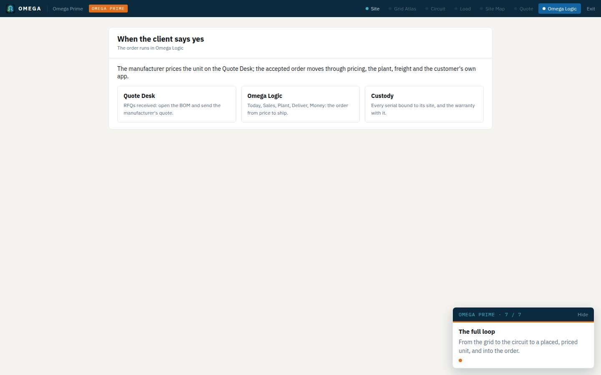

Opened as `/omega-prime?step=logic&project=sample-project`. The visible screen is "When the client says yes". The three links are `/rfq.html#received`, `/omega-logic`, and `/logic-custody.html`. The sample project id is on the query and on `S.editorProjectId`, and none of the links carry it.

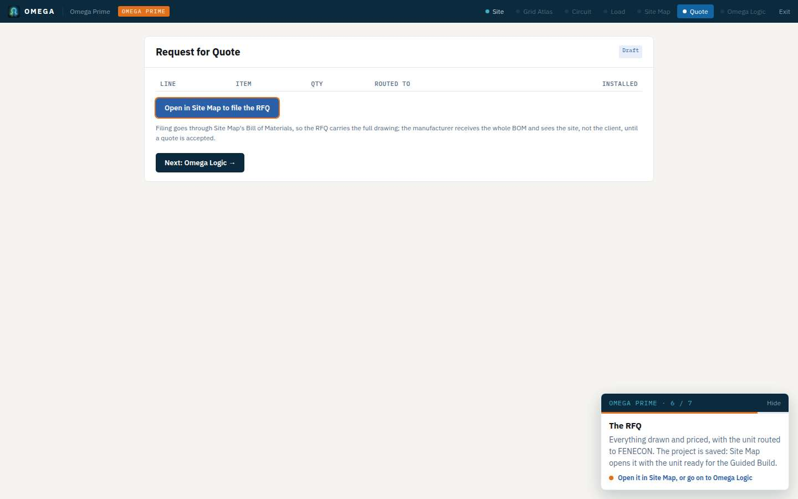

Opened as `/omega-prime?step=quote&project=sample-project`. The table is empty. "Open in Site Map to file the RFQ" points at `#`. "Next: Omega Logic" shows the three links above. Filing still means opening Site Map, opening the bill of materials, typing the ZIP, and sending.

### What the first pull request makes true

Design, then the quote or the BOM, then a purchase order in the OEM's workspace, as one step. The order arrives at Price. The OEM allocates or builds from there, on the path that already exists. The details are W0 below. It does not allocate stock, generate a bill of lading, or take a card payment. Those stay in the later streams.

The same step has to work for a battery, a solar scope, EV equipment, compute, wind, and a microgrid. The match is a published sku. Prime's project type today is a battery button with EV, solar, and compute marked "next", and the record is written `type: 'bess'`. That limit lives in `omega-prime.html` and `projectDoc`, which this plan does not edit. The order function must not copy it.

## How an order is supposed to move

```
Price → Deposit → Build → Final payment → Ship → Deliver → On site → Complete
```

`api/_lib/office-stage.js` `path()` is the rule the desktop, the phone app,
and Today are written to draw. Under it, the same order still carries a
second stage (`quote`, `priced`, `deposit`, `release`, `production`,
`balance`, `ship`, `shipped`, `complete`) and a stored `status`
(`quoted`, `accepted`, `in_fulfilment`, `shipped`, `complete`).

## Map

### Places on the office menu

`omega-logic-theme.js` `groups()` is the desktop menu. The phone menu in
`office/app.html` `menuPanels()` repeats it and adds "on the desktop" rows.

| Place | Menu label | Page | API | Part |
|---|---|---|---|---|
| Today | Today | `/omega-logic?org=` | `GET /api/logic-office` | office |
| Sales | Orders | `/omega-logic?org=#orders` | same | office |
| Sales | Customer POs | `/po-inbox?office=1&org=` | `GET/POST /api/po-intake` | office |
| Customers | Customers | `/portals/customer/admin.html?org=` | `GET /api/buyers`, `GET/POST /api/crm` | customer |
| Plant | Work orders | `/plant/work-orders.html?org=` | `GET/POST /api/logic-plant?page=board` | plant |
| Plant | Serials & registration | `/plant/?org=` | `GET/POST /api/logic-plant`, `POST /api/mes-test-result`, `POST /api/plant-control` | plant |
| Plant | Plant board | `/plant/manager.html?org=` | `GET /api/logic-plant` pages `ops`, `board`, `works`, `units`, `stations`, `attention` | plant |
| Plant | Stations & tablets | same `#stations` | `POST /api/logic-plant` action `station` | plant |
| Plant | Quality & holds | same `#quality` | `POST /api/plant-control` | plant |
| Deliver | Shipping & receiving | `/logic-logistics.html?org=` | `GET/POST /api/logic-logistics` | logistics |
| Deliver | Sites & custody | `/logic-custody.html?org=` | `GET/POST /api/logic-custody` | logistics |
| Deliver | Fleet register | `/logic-register.html?org=` | `GET /api/logic-custody?view=register` | logistics |
| Stock | Inventory | `/logic-inventory.html?org=` | `GET /api/logic-plant?page=stock` and `page=units` | plant |
| Stock | Materials plan | `/logic-materials.html?org=` | `GET/POST /api/logic-materials` | materials |
| Stock | Supplier orders | same `#po` | same | materials |
| Stock | Suppliers & prices | same `#suppliers` | same | materials |
| Money | Cash flow | `/omega-logic?org=#cash` | `GET /api/logic-office` receivables | office |
| Money | Accounting | `/logic-accounting.html?org=` | `GET/POST /api/logic-accounting` | office |
| Setup | Products & bills | `/logic-catalog.html?org=` | `GET/POST /api/logic-catalog` | office |
| Setup | Team | `/logic-team.html?org=` | `GET/POST /api/logic-team` | office |
| Setup | Settings | `/logic-settings.html?org=` | `GET /api/logic-office` | office |
| Setup | Office app | `/office/app?org=` | office, plant, buyers, crm, custody, materials | by part |
| Setup | Plant app | `/plant/app?org=` | `GET /api/logic-plant` | plant |

ClearSky owner only, same menu: All OEM accounts (`/omega-logic` with no
`org`), Subscribers & commissioning (`/logic-admin.html`), This workspace
(`#clearsky`), Website & installation (`/whitelabel-setup.html`), Customer
experience (`/customer-start.html`), URL generator (`/logic-urls.html`),
Apps & guides (`/logic-kit.html`), Production flow
(`/plant/manager.html#flow`), Jarvis Mission (`/mission?view=logic`).

### Phone and customer surfaces

| Who | Page | Tabs or hub |
|---|---|---|
| Office, phone | `/office/app` | Home, Orders, Customers, Sites, Menu. Hub: Today, Sales, Customers, Plant, Deliver, Stock, Money |
| Plant, phone | `/plant/app` | Today, Work, Scan, Stock, Quality |
| Bench | `/plant/station.html` | Paired tablet or roaming phone. Token from Stations. `POST /api/mes-scan` |
| Customer, phone | `/portals/customer/app?org=` | Fleet in the centre; Size, Design, POs, Pay, Shipping, Warranty |
| Customer, desktop | `/portals/customer/?org=` | Same account |
| Customer walkthrough | `/customer-start.html?org=` | Website button. Sizer, then account, then design |
| Sample, no network | `/app-sandbox/office`, `/plant`, `/customer`, `/bench` | Same four pages on fixture data |

`api/_lib/kit.js` is the address list. `api/logic-workspaces.js` is who may
open a company after sign-in. `omega-logic-signin.js` is the one sign-in.

### Files

| Concern | Files |
|---|---|
| One path | `api/_lib/office-stage.js`, drawn by `omega-logic-theme.js`, `omega-logic.html`, `office/app.html` |
| Who may write | `api/_lib/logic-access.js` (`authorize`, `requirePricer`, `requireOwner`), `api/_lib/logic-members.js` |
| Price, accept, invoice, release, ship | `api/_lib/logic-workflow.js`, `api/logic-office.js` |
| Purchase orders | `api/po-intake.js`, `omega-po-bulk.js`, `po-inbox.html`, `customer-po.html` |
| Customers | `api/_lib/buyer-accounts.js`, `api/buyers.js`, `api/_lib/crm.js`, `api/crm.js`, `api/my-orders.js`, `api/my-files.js`, `api/my-sites.js`, `api/customer-subscribe.js` |
| Plant | `api/_lib/plant-work.js`, `api/_lib/plant-stats.js`, `api/logic-plant.js`, `api/mes-scan.js`, `api/mes-test-result.js`, `api/plant-control.js`, `plant/*` |
| Stock and purchasing | `api/_lib/materials.js`, `api/logic-materials.js`, `api/logic-catalog.js` |
| Freight, loads, custody | `api/_lib/freight.js`, `api/_lib/order-lifecycle.js`, `api/_lib/custody.js`, `api/logic-logistics.js`, `api/logic-custody.js` |
| Money | `api/_lib/receivables.js`, `api/logic-accounting.js` |
| ClearSky control | `api/logic-admin.js`, `api/_lib/logic-admin.js`, `api/logic-kit.js`, `api/logic-urls.js`, `whitelabel-setup.html` |
| Sample and render | `scripts/_lib/logic-fixtures.js`, `scripts/render-logic-pages.js`, `scripts/audit-logic-walk.js` |

### Firestore

Admin SDK only unless noted. Browsers are denied.

| Record | Where |
|---|---|
| Order, price, invoices, requests, delivery legs | `orders/{id}`, events in `orders/{id}/events` |
| Work order | `plant_works_orders/{id}` |
| Serial, station, hold, test, custody | `plant_units/{org__serial}`, `plant_units/{id}/custody_events` |
| Scans | `plant_scans` |
| Paired tablets and rigs | `plant_stations` |
| Catalog and engineering fields | `omega_orgs/{org}/storefront/config` |
| On-hand counts, supplier prices, buy orders | `omega_orgs/{org}/fulfillment/materials`, `fulfillment/suppliers`, `purchase_orders` |
| Freight quotes | `omega_orgs/{org}/freight_quotes` |
| Customer account, people, CRM | `omega_orgs/{org}/customers/{id}` plus `users`, `contacts`, `activity`, `files`; pointer `customer_index/{email}` |
| Sites | `omega_orgs/{org}/sites` |
| Office terms, who invoices | `omega_orgs/{org}/fulfillment/config` |
| Team | `omega_orgs/{org}/members/{uid}` |
| Subscription | `omega_orgs/{org}/billing/current` |
| Staff changes | `omega_orgs/{org}/admin_audit` |
| CRM follow-ups and upload counts | `crm_followups`, `crm_upload_usage` |
| Custody spreadsheet imports | `custody_imports`, `custody_mappings` |
| Apps & guides sends | `kit_sends` |
| Reps | `omega_orgs/{org}/reps` |
| Cross-cutting audit rows | `omega_audit` — written by the API, **not named in `firestore.rules`**. Closed only because an unnamed path is denied. `stripe_customers` and `stripe_events` are the same shape. |

`scripts/tests/tlogiccleanup.js` fails if a page in this map disappears or
a named collection above drops out of `firestore.rules`.

## What the walk showed

42 office, plant, customer, and staff pages returned HTTP 200. Prime's
Quote and Omega Logic screens were opened the same way (`--only
prime-quote,prime-logic`); both returned HTTP 200 and are the handoff
figures above. The white-label setup page painted its four
steps; the sample server has no Firestore, so that page's save path was
not exercised. The bench opened on **Pair this bench** until a station
token exists. That is the real first screen of an unpaired tablet.

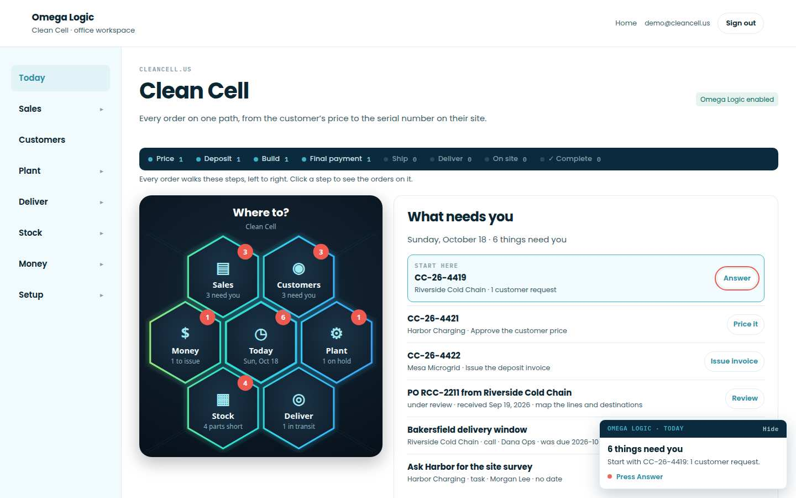

Today draws the hub and "What needs you". The same page also draws Orders,
Cash flow, On the floor, and Deliveries below the fold, so one URL is five
dashboards.

## Sales

**Severity: high.** Inside the OEM office, the path bar and the status
chips describe one order in two languages. That order exists because
someone typed a PO. How a design fails to become that PO is the journey
above.

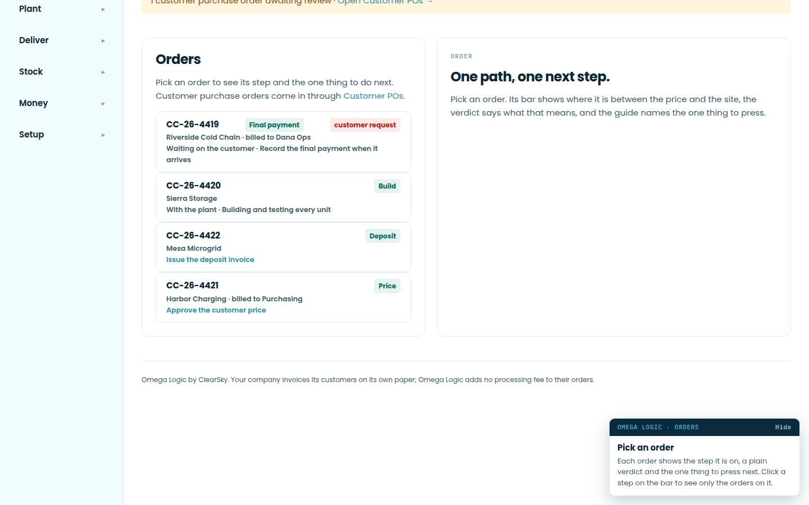

On the sample order CC-1042 the bar is on **Build** and the chip says
**In production**. CC-1044 is on **Final payment** in both, then the chip
adds "Awaiting final payment". `stageOf()` still has Awaiting price,
Priced, Awaiting deposit, Releasing to plant, In production, Ready to ship,
Shipped. `path()` has Price, Deposit, Build, Final payment, Ship, Deliver,
On site. `orders.status` has a third set (`in_fulfilment`, `quoted`,
`accepted`). A person cannot point at one word and know the order moved.

Other sales findings:

| Severity | What the walk and the code show |
|---|---|
| High | There is no quote and no pipeline before an order. Sales starts when a PO is typed, pasted, or uploaded. Reps are a name on the PO inbox. |
| Medium | Two doors for the same PO: **Customer POs** (`/po-inbox`) and **Enter POs** inside the phone Menu. Opening `/customer-po` alone says "Open a PO from the company inbox first." |
| Medium | The phone Menu row **Price & accept on the desktop** sends the person who may price back to this same orders page. Approving a price inside the phone app is intentionally absent (manual, section 6). The menu still offers it as a destination. |
| Medium | A member is told they "work at the benches" (Team). `logic-access.authorize` allows a member to read. Pricing, invoices, holds, and a hand-recorded test require an owner or administrator. The bench itself is a station token, not a person. |
| Low | The PO inbox status on an empty company is "Choose a company or add a company account." That part works. Email intake is a section on the same page. |

Acceptance for the sales pull request: one vocabulary on the order list,
the order page, Today, and the phone order. The chips use the path step
names. `stageOf()` may remain as the engine's internal key. A member's
order shows whose step it is and offers no price button. One PO entry
point.

## Customers

**Severity: medium.** The account hub is real. The desktop and the phone
do not open it the same way, and the customer front door is a battery sizer.

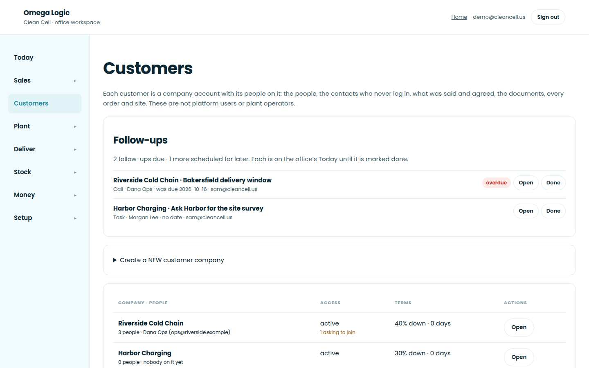

The desktop list shows company, balance, orders, people waiting, and the
next follow-up. Opening an account is `GET /api/buyers`, which is an
administrator's call. A member is refused there. The phone app builds a
thinner account from the PO intake record so a member can still see the
company. The CRM write API (`api/crm.js`) already allows a member. Two
doors, two answers.

The customer app, on the same sample, opens Riverside Cold Chain on Fleet,
Size, Design, POs, Pay, Shipping, and Warranty. Pay opens the supplier's
link. There is no card payment inside the app. Shipping can still say a
unit is on its way after custody has received it, until Shipping &
receiving records the load (manual, "Not built").

`/customer-start.html` is the website button. With no storefront key the
sample says the sizer is being configured. The URL generator's fifth row
is labeled **Battery sizer**. The catalog status line says "Editor Lite
uses your enabled BESS products." The order, the BOM, and the serial are
already product-neutral. The words in front of a solar, EV, compute, wind,
or microgrid tenant are not.

Acceptance: a member and an administrator open the same account, read-only
for the member. Customer-facing strings say the product the catalog sells,
not "battery", unless that tenant's catalog is batteries. Warranty claims,
email sync, and in-app card pay stay off the main customer tabs until they
exist; Pay and Shipping stay, and they say what they do today.

## Plant and production

**Severity: high.** Four surfaces show the same work order.

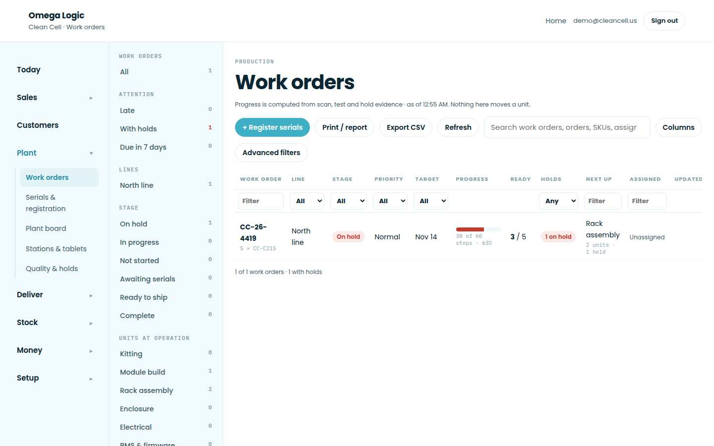

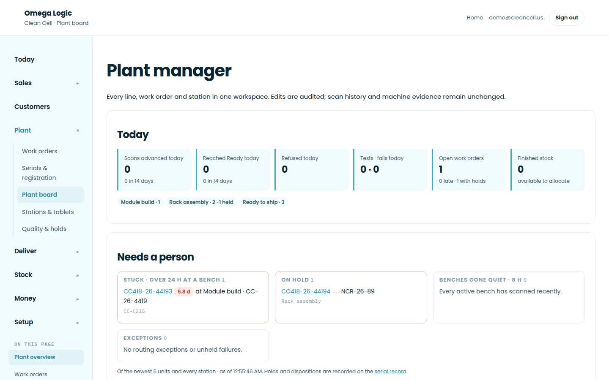

| Screen | What it repeats |
|---|---|
| Work orders | The line, stage, target, parts, assignment |
| Plant board | The same work-order table, plus Today, an attention strip, and **Floor performance · 14 days** drawn as em dashes |
| Serials & registration (`/plant/`) | "Factory & traceability", another work-order list, stations, and recent scans |
| Plant app | Today, Work, Scan, Stock, Quality |
| Menu rows Stations and Quality | Hashes of the plant board (`#stations`, `#quality`) |

A work order is created when the order is released (`logic-workflow.js`).
`api/_lib/plant-work.js` explodes the catalog BOM into bench steps. On the
sample catalog the page itself reports "2 bills have lines no bench issues
(CC-C215, CC-MOD-52)". Release does not require a bill. A product with no
BOM still gets a work order.

The floor chart is honest about missing times (a station with fewer than
three timed units has no time) and still looks like a broken dashboard.
Production flow (`#flow`) is published by ClearSky. A tenant administrator
reads it and does not change the routing their benches run.

Quality holds and a hand-recorded test are owner or administrator actions.
A failed test blocks the next bench. That part is enforced.

Acceptance: the menu has one Plant item, Work orders. Stations, quality,
and a serial open from that order. The empty performance chart is a
Features toggle, off until a station has times. Releasing an order whose
product has no bill is refused, or the order is marked "no bill" in the
work-order row. Do not invent a second production order type.

## Stock

**Severity: high.** The materials plan is a shopping list. It does not
reserve parts for an order.

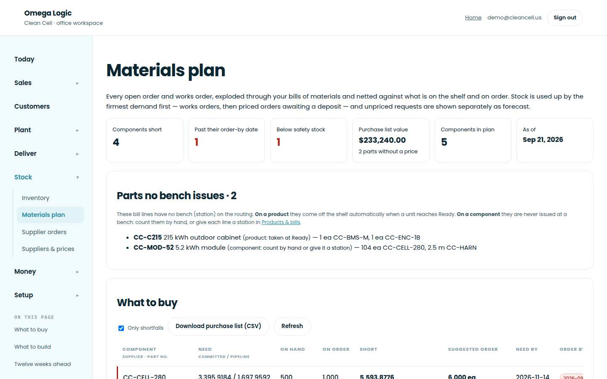

`api/_lib/materials.js` nets on-hand plus on-order against committed,
pipeline, buffer, and forecast demand. Two open work orders can both show
the same cells as available. Quantity is taken off the shelf when a bench
issues it (`api/mes-scan.js`) or when a finished unit is assigned
(Inventory → Assign). There is no allocation record on the work order.

The menu lists four stock doors that are two pages:

- **Inventory** — finished units (on the shelf, promised, in production) and a second table of on-hand / short parts.
- **Materials plan**, **Supplier orders**, and **Suppliers & prices** — three hashes of `/logic-materials.html`.

Buy prices live only on supplier records. That boundary is right. Landed
cost, a second warehouse, and an RFQ to a supplier are not built (manual,
section 6).

The catalog is the product master and it works. Its status line is
BESS-specific, and bills can contain lines no bench will issue.

Acceptance: one Stock item, Materials. Inventory's finished-unit assignment
stays as a section of Materials or of the work order. Supplier orders and
prices stay as sections, not menu rows. A later reservation change is its
own pull request against `api/_lib/materials.js` only: issuing a part
cannot drive on-hand negative for a second order without a named exception.
This audit does not design that reservation.

## Ship, deliver, custody

**Severity: high.** The only shipping screen says it does not ship.

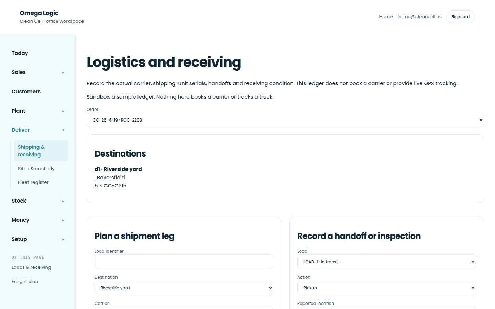

The live API notice (`api/logic-logistics.js`) is: "Manual shipment
evidence ledger. Carrier booking, live tracking and commissioning approval
are not connected." A load stores a carrier and a booking reference a
person typed. That reference is the bill of lading. Nothing generates a
packing list, a label set, or a commercial invoice from the serials on the
load. The freight plan (same page, `#freight`) groups sites into lanes and
stores carrier quotes. Accept plans legs through `order-lifecycle.js`.
Rate shopping, road miles, and a multi-stop bill of lading are not built.

Three Deliver menu rows open the same units:

| Row | Page | Same records |
|---|---|---|
| Shipping & receiving | `logic-logistics.html` | Loads and the freight plan |
| Sites & custody | `logic-custody.html` | Passport, sites, scan session, import, coverage |
| Fleet register | `logic-register.html` | One spreadsheet row per serial, edited through the same custody API |

Custody status (`in_transit`, `delivered`, `received`, `assigned`,
`commissioned`, `in_service`) is a fourth vocabulary beside the order path's
Deliver and On site. On site means every shipping unit has `custody.siteId`.
Confirming a customer's declaration does not hold the order. That rule is
sound. The customer's Shipping tab does not read it until the load is
marked delivered on the ledger.

Acceptance: the menu has Shipping and Sites. Fleet register is a Features
toggle, off, opening as a view of Sites when switched on. The shipping
page keeps the manual-ledger sentence at the top. A generated bill of
lading is a later pull request, not a button that pretends one exists.

## Money and the back office

**Severity: high.** Cash flow and Accounting print the same totals, and
the correction tools sit disabled until an invoice is chosen. QuickBooks
connect is on the page and cannot be pressed.

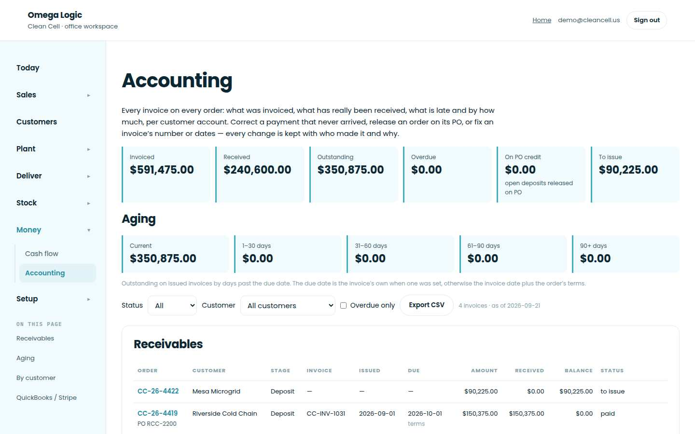

The sample's receivables are real numbers from `api/_lib/receivables.js`:
invoiced, received, outstanding, overdue, to issue. Cash flow on
`/omega-logic#cash` prints those same tiles and links to Accounting.
Recording a payment updates the order's deposit or balance invoice. The
page says a recorded payment is not bank clearance. QuickBooks and Stripe
sync are a second ledger (`logic-accounting` sync). On the sample, Stripe
is connected and **Connect QuickBooks** is disabled because the deployment
has no QuickBooks credentials. A tenant-billed invoice is marked issued
and paid by hand. The customer pays on the supplier's own link. Voids,
edits, and "release on PO" are desktop-only and disabled until a row is
selected, which reads as broken on arrival.

There is no single trail on the order. Price and acceptance write
`logic.pricedBy` / `acceptedBy` and an order event. Bench issues write
`plant_scans`. Custody writes `custody_events`. Money corrections write
`omega_audit`. Staff edits write `admin_audit`. Each page shows its own
slice.

Acceptance: Accounting is the only Money item. Cash tiles move onto
Accounting (or stay as a Features view of the same totals). Connect
QuickBooks is hidden until that deployment is configured. The order page
gains no new payment math in this pull request; it links to the invoice
row. A later pull request can add one "Activity" list that reads the
existing events. It must not create another log.

## Setup and admin

**Severity: medium.** Settings explains the workspace and has no Features
section. Staff tools and half-finished tools sit on the daily menu.

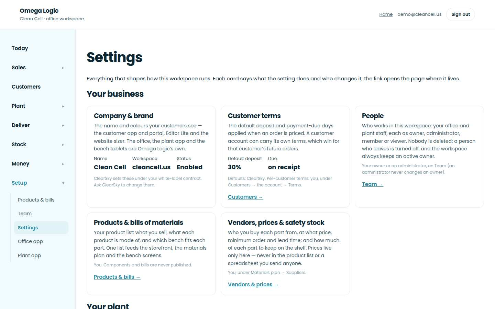

Settings cards point at Team, catalog, vendors, production flow, stations,
quality, and the subscription. They do not switch anything. The desktop
nav still lists Office app and Plant app as places, next to the work those
apps repeat.

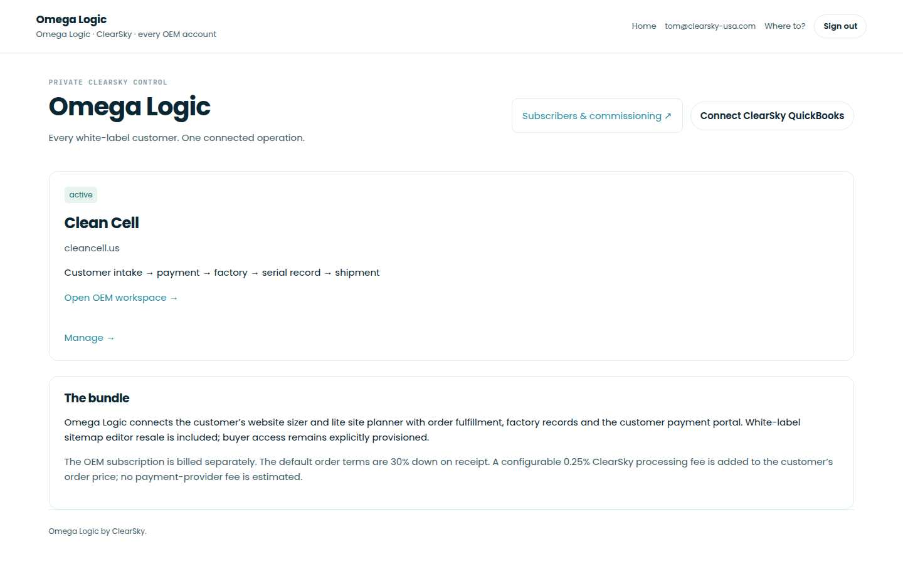

`/omega-logic` with no company is the ClearSky directory: every
white-label account, **Connect ClearSky QuickBooks**, and **Subscribers &
commissioning**. That is the all-OEM view. A tenant who follows a Prime
link must not land here (the other agent's fix). This audit does not change
that link.

`/logic-admin.html` opens the subscriber list and, for one workspace, the
tenant record, subscription, white label, storefront copy, members, and
the admin audit. `/logic-kit.html` lists every app and a message per
audience. `/logic-urls.html` copies website links, including **Battery
sizer**. White-label setup writes Firestore directly; it is ClearSky's
last mile, not an OEM daily page. It is already staff-only.

Team roles, quoted from the page:

| Role | What it can do |
|---|---|
| Owner | Everything an administrator does, plus owners |
| Administrator | Price and accept self-billed orders, invoices and payments, plant and stock, people up to administrator |
| Member | See orders, customers, POs, and stock. Work at the benches. No pricing, money, or people |
| Viewer | See the workspace, change nothing |

There is no sales role, no planner, no warehouse role, no shipping role,
and no finance role. An administrator is all of those. Adding finer roles
would be a new grant. This plan does not add grants. A later change may
only narrow what a viewer or member can read (cost prices, bank
references).

Acceptance: Settings gains a **Features** section in the shape of
`omega-editor-features.js`. Each row names the menu item, why it is off,
and where it returns. Defaults below are off. Turning one on puts that
item back. A locked row stays off. Staff-only links never appear for a
tenant, which is already true for the ClearSky group.

### Proposed Features rows (off until switched on)

| Id | Item | Why it leaves the main menu | Returns to |
|---|---|---|---|
| `plant-board` | Plant board, including the floor chart | Duplicate of Work orders; chart has no times | Plant |
| `plant-serials` | Serials & registration | Duplicate of the work order and the passport | Plant |
| `plant-stations-nav` | Stations as its own menu row | Already a section of the plant page | Plant |
| `plant-quality-nav` | Quality as its own menu row | Already a section of the plant page | Plant |
| `fleet-register` | Fleet register | Same units as Sites & custody | Deliver |
| `cash-flow` | Cash flow as its own menu row | Same totals as Accounting | Money |
| `nav-apps` | Office app and Plant app on the desktop menu | Install links, not a daily place | Setup |
| `qbo-connect` | Connect QuickBooks | Disabled until the deployment has credentials | Money, staff |
| `po-enter-app` | Enter POs as a second door | Customer POs already accepts a stack | Sales |
| `price-desktop` | "Price & accept on the desktop" | The orders page is already open | Sales |

Locked, and absent from the menu even for staff who are not the owner:
Jarvis Mission, URL generator, Website installation, Production flow
publish. They stay on the ClearSky group only.

Copy that says "battery" or "BESS" on a shared page is a string change in
the catalog and URL workstream, not a hidden feature. A tenant whose
products are batteries still shows those product names from the catalog.

## ERP basics

| Basic | Where it stands | Severity |
|---|---|---|
| One state machine, enforced on every page | Three vocabularies. Buttons are enforced by their own endpoints (`requirePricer`, release, ship). The words are not. | High |
| Work orders tied to a BOM | Steps come from the bill when it has stations. Release does not require a bill. The catalog warns about lines no bench issues. | High |
| Stock reservations | Netting only. Issue-at-scan and assign-a-finished-unit are the moments stock moves. | High |
| Shipment documents | A typed booking reference. No generated packing list, labels, or bill of lading. | High |
| Invoices and payments per order | Deposit and balance live on the order and in the receivables ledger. A recorded payment is not bank clearance. QuickBooks connect is disabled in the sample. | High |
| Audit trail | Written in five places. No one list on the order. `omega_audit` is not named in the rules. | Medium |
| Roles for sales, ops, plant, finance, customer | Owner, administrator, member, viewer. The customer is a separate account (`customers/{id}/users`). | High |

## Parallel workstreams

W0 is first. It is the design-to-PO step. The others clean one area of the
office and can run beside it, because they do not share its files. Each
pull request owns the files listed and no others. Do not edit `package.json`
except W0, which may append `scripts/tests/tdesignorder.js` to `test:logic`.
Other tests run as `node scripts/tests/<file>.js`. Do not edit
`omega-prime.html`, editor v2, or this audit's screenshots. Do not change
the Prime card that opens `/omega-logic` with no company.

Leave the menu alone in every pull request except **W1**. A page can lose
a dead button without the menu knowing. W1 hides the menu row.

### W0 — Design, then the OEM's purchase order

This is the first pull request. Filing the bill of materials creates the
order in the OEM's workspace, waiting at Price.

Owns `api/_lib/design-order.js` (new), `api/rfq.js` (after the RFQ is
written, one order per OEM whose catalog matched), `rfq.html` (the received
row links to that order), `scripts/tests/tdesignorder.js`. The editor's
send button already posts `/api/rfq`. Change the success sentence only if
the API's order id has to be named there, and only that sentence. Do not
own `omega-prime.html`. Do not own `po-inbox.html` (W3). Do not own
`api/_lib/buyer-accounts.js`; create the customer through a new helper in
`design-order.js` that calls the account writer already there, and if that
call cannot be made without editing the account file, stop and leave the
customer as the contact the RFQ already stores, named on the order.

`design-order.js` is pure. It takes the project id, the project name, the
address string, the designer's org and email, the BOM lines in the editor
shape `{ sku, description, qty, unit, category, manufacturer }`, and the
OEM's published products. It returns the body `order-lifecycle.js` `po()`
already accepts: published sku, name, kind, whole-unit qty, one destination.
It also returns `projectId`, `rfqId`, and `source: 'design'`. A line that
is not a published product is listed on `unmatched` with the words from the
drawing. It is not dropped quietly and it is not written as an item.

The address string is kept whole on the destination when it cannot be split
into street, city, state, and ZIP. The OEM confirms it. Nothing is invented.
The designer's Run total may be stored beside the order as
`design.estimate`. It is not the price. Price still types the price.

The order's `orgId` is the OEM the RFQ already resolved, never the staff
directory. A distributor who was ticked still gets the RFQ they get today.
They get a Logic order only when one of their published skus is on the
line. When the designer is the OEM — a Clean Cell rep who drew the job —
the order is written in that same workspace. Today the RFQ refuses to send
a manufacturer their own drawing; this step still files the PO there.

The same function accepts Prime's record as a second input: `prime.unitKey`
or the catalog key on `bessList`, quantity 1, the address, the project id.
A test feeds that shape and an editor BOM that names the same published sku
and asserts one item list, one destination, and the same `projectId`. The
call from `omega-prime.html` is a later change of that file, once it is
free. Until then, Site Map's File RFQ is the step that creates the PO,
which is the door Prime already points at.

Acceptance, in `scripts/tests/tdesignorder.js`:

- An editor BOM with one published sku and one install line creates one
  order in the OEM org. Items are the sku and the qty. The install line is
  `unmatched`. `projectId` is on the order. No price is written. Status is
  the office's waiting-for-price state.
- Prime's unit key for that same sku produces the same items, destination,
  and project id.
- A BOM whose lines match no published product creates no order and names
  every line.
- The designer's org and the OEM's org differ: the order is in the OEM's.
  They are the same org: the order is still created.
- A solar sku and a battery sku through the same function produce the same
  shape. No branch on project type.

### W1 — Settings › Features

Owns `omega-logic-features.js` (new), `logic-settings.html`,
`omega-logic-theme.js` (`groups()` only), `office/app.html` (the menu
arrays only), `scripts/tests/tlogicfeatures.js`.

Ship the registry and the Settings section. Default every proposed row to
off, matching the editor: a person's choice, then a workspace default an
owner can set, and off when nobody has chosen. Locked rows have no
working toggle. Staff group is unchanged.

Acceptance: with a clean localStorage the desktop menu and the phone menu
no longer show the ten rows in the table above. Switching Fleet register
on puts that one link back. A viewer cannot write the workspace default.
`node scripts/tests/tlogicfeatures.js` covers the default, the override,
and the locked row.

### W2 — One order language

Owns `api/_lib/office-stage.js` (labels only; do not change who may press
a button), `omega-logic.html`, `scripts/tests/tlogicpath.js` (extend
`scripts/test-office-stage.js` if that stays the home of the rule — then
W2 is the only editor of that test).

The order list, the order panel, and Today print the path step. Internal
keys can stay. Cash flow and the floor blocks on this page stay until W1
hides their menu entries; W2 does not delete those sections if W1 has not
landed. If both are in flight, W2 only changes the words in the orders
panel.

Acceptance: the sample orders render one step name in the bar, the chip,
and the guide. A member still cannot price. Existing
`scripts/test-office-stage.js` stays green.

### W3 — One PO door

Owns `po-inbox.html`, `customer-po.html`, `omega-po-bulk.js` if the paste
parser must change. Does not own `office/app.html` (W1 removes the extra
menu row). Does not own `api/rfq.js` or `api/_lib/design-order.js` (W0).

Acceptance: a stack of POs is entered from Customer POs. `/customer-po`
opened with no PO explains that and links to the inbox. Nothing is priced
or charged from this page.

### W4 — Customers

Owns `portals/customer/admin.html`, `portals/customer/index.html`,
`portals/customer/app.html`, `customer-start.html`, `api/buyers.js` only
to allow a member to **read** an account the CRM already lets them read.
That is a narrowing of the surprise, not a new write. If the read cannot
be a strict subset of what `api/crm.js` already returns, stop and leave
the API alone; fix the phone so it does not invent a second account.

Owns no billing and no `api/customer-subscribe.js` price change.

Acceptance: member and administrator see the same sections; the member's
write buttons are absent. A fixture customer with a solar product name
does not see the words "battery" or "BESS" on the walkthrough or the URL
list. Add the URL strings only if W9 has not taken `logic-urls.html`.

### W5 — Plant

Owns `plant/work-orders.html`, `plant/manager.html`, `plant/index.html`,
`plant/app.html`, `plant/station.html`, `api/logic-plant.js`,
`api/_lib/plant-work.js`.

One work-order page. Stations, quality, and the serial open from it. The
performance chart renders only when a station has at least three timed
units; otherwise the section is omitted. Release of a hardware line with
no bill is named on the work order.

Acceptance: `scripts/render-logic-pages.js` plant checks still pass.
A product with an empty bill is visible as "no bill" on the sample work
order. Menu labels are W1's job.

### W6 — Stock

Owns `logic-inventory.html`, `logic-materials.html`, `logic-catalog.html`,
`api/logic-materials.js`, `api/logic-catalog.js`, `api/_lib/materials.js`
only for a guard that refuses a silent negative issue. No new collection.

Catalog status text drops "BESS products" for "published products".

Acceptance: supplier orders and prices are sections of Materials. The
catalog page no longer says BESS. An issue that would drive on-hand
negative is refused with the sku named. Prices stay out of the public
catalog projection.

### W7 — Deliver

Owns `logic-logistics.html`, `logic-custody.html`, `logic-register.html`,
`api/logic-logistics.js` (notice text only), `api/logic-custody.js` only
if the register must deep-link to a passport.

Acceptance: the shipping page shows the manual-ledger sentence from the
API, not a sandbox slogan. Fleet register, when opened, is the same units
as Sites. No new document type in this pull request.

### W8 — Money

Owns `logic-accounting.html`, `api/logic-accounting.js`,
`api/_lib/receivables.js` only for display strings.

Connect QuickBooks renders only when `sync.quickbooks.configured` is true.
Disabled correction buttons sit inside the invoice panel, after an invoice
is open, rather than in a row above an empty selection.

Acceptance: the sample page does not show a disabled Connect QuickBooks.
Choosing an invoice enables Void, Edit, and Record payment for an
administrator and leaves them absent for a member. Totals still come from
`receivables.js`.

### W9 — Staff copy

Owns `logic-urls.html`, `logic-admin.html`, `logic-kit.html`,
`api/logic-urls.js`.

"Battery sizer" becomes "Product sizer" (the public sizing page). No
change to who may open these pages (`requireOwner` stays).

### W10 — Name the audit collection

Owns `firestore.rules` only, adding:

```
match /omega_audit/{id} { allow read, write: if false; }
```

No other rule changes. This tightens an implicit deny into an explicit
one, which is the pattern `agent_keys` already uses. Acceptance: the new
test asserts that block and that it is `if false`.

### Not in this round

Finer roles, stock reservations as a data model, a generated bill of
lading, in-app card payment, carrier APIs, warranty claims, and merging
two customer accounts. They are real gaps. Each one is larger than a
single area pull request and would touch shared order code. They wait
until W0 and W1–W8 have landed.

The card on Prime that opens `/omega-logic` with no company is not a
workstream here. Another agent is pointing it at the person's own
workspace. W0 creates the order; that card should open the order once
both have landed, and neither pull request edits the other's file.

## Walking it again

```
node scripts/tests/tlogiccleanup.js
node scripts/audit-logic-walk.js --out /tmp/logic-walk
node scripts/audit-logic-walk.js --out /tmp/logic-walk --only prime-quote,prime-logic
```

The walk needs Playwright or `playwright-core` and Chrome (`$CHROME` or
`/opt/google/chrome/chrome`). It binds `127.0.0.1`, signs in as the sample
personas above, and writes `report.json` plus one JPEG per page. It skips
with exit 0 when the browser is not installed. It is not on `npm test`.
The map test is on `npm run test:logic`.
